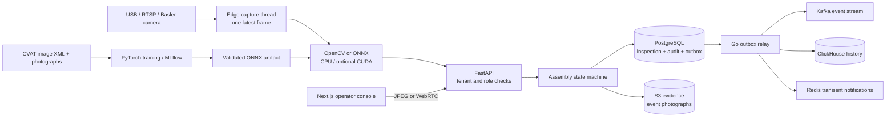

# Architecture

## Assembly State Machine

The state is replayable JSON. Each observation has a monotonically increasing inspection sequence. Stale/repeated network delivery is rejected before updating counts. An inspection stores its workflow snapshot so later workflow edits cannot silently change acceptance criteria.

- Three stable frames are required by default; the workflow can choose 1–30.
- An installed component remaining visible is not a repeated installation.
- Removing an installed component for the stability interval creates a missing fault. Reappearance then creates a repeated-step fault.
- A future component stabilizing before its predecessor creates an incorrect-order fault. Simultaneous first appearance does not establish a sequence.
- Zone containment checks the full bounding box, not only its center.
- Orientation uses an undirected long axis modulo 180°. Nearly square masks and detector outputs without pose have `angle=null`; configured orientation cannot be verified from unknown pose.
- Finishing early records omitted steps. Uncertain observations never advance progress.
- Faults latch. Ordinary approval requires all steps currently stable, no latched faults, and awaiting-approval state.
- Review decisions require an expected row version and reason. An administrator can explicitly override; rework resets progress without deleting previous events or resetting the delivery sequence.
- PostgreSQL row locks and a local SQLite development lock serialize updates. One source camera per inspection prevents contradictory multi-view observations from silently advancing one state.

## Storage and transactions

PostgreSQL holds tenant-scoped records, inspections, append-only API events, and optional outbox rows. Tenant IDs come from the API-key identity, never from a request body. Event and state changes commit in the same database transaction. Object writes happen before commit; a failed transaction can leave an orphaned object, which the lifecycle eventually removes. This is not a distributed transaction.

Evidence is re-encoded as JPEG and hashed. Local paths use generated IDs; uploaded filenames never select filesystem destinations. The S3 object layout is tenant / inspection / generated evidence ID. Default retention is 90 days in the local stack. Model files use generated IDs and recorded SHA256. Database audit records survive evidence expiry.

Outbox delivery is **at least once**. The Go relay locks pending rows with `FOR UPDATE SKIP LOCKED`, publishes Kafka messages keyed by event ID, writes ClickHouse, emits a Redis notification, then marks the transaction delivered. A crash between sinks can duplicate earlier writes. Consumers must deduplicate event IDs; ClickHouse uses ReplacingMergeTree, with `FINAL` or an explicit latest-row aggregation where duplicate-sensitive counts matter.

Redis pub/sub is a hint channel, not durable evidence. Kafka carries inspection events, not every video frame. The current console reads PostgreSQL operational summaries; ClickHouse is available for downstream long-history analysis rather than masquerading as an already-integrated dashboard backend.

## Scaling strategy and actual limits

For 100 cameras, place inference on several edge gateways rather than sending all full-resolution video to one API process. Each camera has one bounded capture buffer and one request in flight. At 4 processed FPS, 100 cameras generate up to 400 observation writes/s. This is a sizing assumption, not a demonstrated service-level objective.

The pilot API serializes mutation work locally and performs browser inference inside that critical section. It is not designed to process 100 full image streams in one process. Use edge observations, profile gateway capacity, separate inference from DB transaction time, and partition deployment by facility before expanding.

For 10 million inspections: benchmark representative indexed serial/time/tenant queries, partition inspection/event history by time, add keyset pagination, archive completed workflow snapshots where appropriate, define ClickHouse materialized views, and test backup/restore. The current schema has relevant compound indexes and bounded reads but no proven 10M-row benchmark. Offset pagination and generic JSON records are pilot trade-offs.

Storage formula (before replication):

`retained photographs/day = inspections/day × evidence events/inspection`

`bytes/day = photographs/day × measured JPEG bytes + clips/day × measured clip bytes + metadata growth`

At 10,000 inspections/day, 5 events each and 100 KB/JPEG, photographs alone are about 5 GB/day and 450 GB over 90 days. These are illustrative assumptions, not measured factory data. See benchmark JSON for the actual synthetic-image JPEG size.

## Explicit boundaries

No machinery actuation, PLC writes, automatic line stops, hidden-connection claims, functional electrical tests, or safety certification. No real factory dataset, validated arbitrary-part model, SSO, automated fleet rollout, multi-view pose fusion, or tamper-proof audit ledger is bundled.
